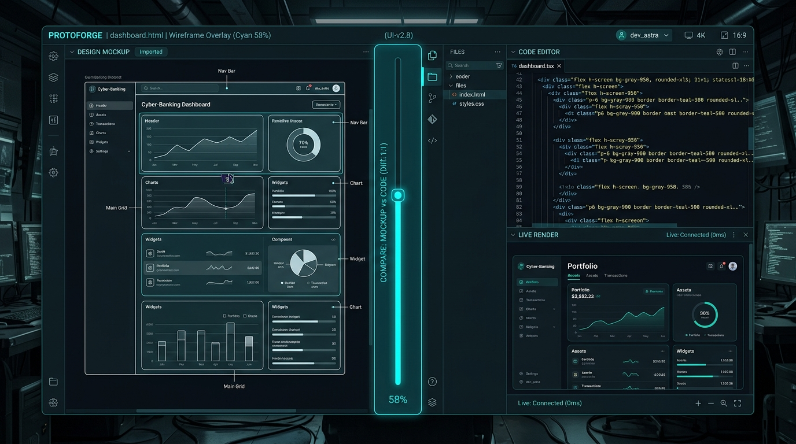

<div align="center">

# ⚡ VisionCraft

### Screenshot-to-Fullstack Live Sandbox & 1:1 Ghost Diff Engine
**Turn any UI screenshot, Figma clip, or mockup into live, production Tailwind CSS & React code in seconds.**

<br />



<br />

[](https://github.com/SECRET4422/vision-craft/actions)
[](https://npmjs.com/package/@ssgk4422/vision-craft)
[](https://opensource.org/licenses/MIT)
[](http://makeapullrequest.com)

[**Quickstart**](#-quickstart) •
[**Interactive Sandbox**](#-live-interactive-dual-sandbox) •
[**Architecture**](#-architecture) •
[**Ghost Diff**](#-11-pixel-accuracy-ghost-diff) •
[**AlphaTech Studio**](https://alphatech.studio)

</div>

---

## ⚡ The Problem

When frontend developers or vibe-coders attempt to replicate an interface from a screenshot or mockup:
- ❌ **Prompt Tuning Fatigue:** You spend 20 minutes typing prompt descriptions trying to get an LLM to replicate padding, fonts, and hex colors.
- ❌ **Blind Code Generation:** Code generators spit out raw JSX into your terminal without letting you see or interact with the running result.
- ❌ **Alignment Drift:** You have no easy way to check if the generated output actually matches the source design pixel-by-pixel.

## 🛰️ The Solution: VisionCraft

**`VisionCraft`** is a zero-prompt, browser-based visual studio running locally on `localhost:5050`. Drop any screenshot or paste directly from clipboard (`Ctrl+V`), and VisionCraft:
1. **Extracts Design Tokens:** Identifies primary palettes, surface elevation, text colors, and computes WCAG AA contrast.
2. **Synthesizes Production Code:** Compiles clean semantic Tailwind CSS + HTML and React JSX with zero runtime framework overhead.
3. **Live Dual Sandbox:** Renders an interactive 60 FPS live preview side-by-side with your original source image.
4. **1:1 Ghost Diff Slider:** A draggable overlay slider that overlays the rendered DOM directly onto your source screenshot for pixel-accuracy verification.

```
┌────────────────────────────────────────────────────────────────────────┐
│                        VisionCraft Studio                              │
│                                                                        │
│   ┌───────────────────────────┐      ┌───────────────────────────┐     │
│   │  Original Source Mockup   │      │   Live Interactive App    │     │
│   │  (Drop / Paste Ctrl+V)    │  ◄┼► │   (Tailwind HTML / React) │     │
│   │                           │      │                           │     │
│   └────────────┬──────────────┘      └───────────▲───────────────┘     │
│                │                                 │                   │
│                ▼                                 │                   │
│   ┌───────────────────────────┐                  │                   │
│   │ Image Token Extraction    ├──────────────────┘                   │
│   │ (Palettes, Radii, Layout) │      Ghost Diff Overlay (Difference)   │
│   └────────────┬──────────────┘                                        │
│                ▼                                                       │
│   ┌────────────────────────────────────────────────────────────────┐   │
│   │ Code Drawer: Tailwind HTML | React JSX | Export Vite Project   │   │
│   └────────────────────────────────────────────────────────────────┘   │
└────────────────────────────────────────────────────────────────────────┘
```

---

## ⚡ Quickstart

Launch the studio instantly with zero configuration:

```bash
# Launch VisionCraft local live studio
npx @ssgk4422/vision-craft
```

Or run on a custom port:

```bash
npx @ssgk4422/vision-craft --port 8080
```

Your browser will automatically open to `http://localhost:5050`.

---

## 🎨 5 Built-in Flagship Presets

Test the engine instantly without needing to take a screenshot:
1. **Linear Issue Radar (Dark):** Keyboard-first sprint issue board with glowing status chips, sidebar, and cycle progress tracker.
2. **Stripe Global Checkout (Fintech):** Apple Pay enabled subscription payment form with live invoice summary.
3. **Glassmorphic Agent Terminal (AI):** Futuristic telemetry HUD with real-time stream logs and killswitch triggers.
4. **SaaS Launchpad Hero (Marketing):** High-converting gradient badge hero section with feature grid and CTA buttons.
5. **Apex Crypto Vault (Web3):** High-contrast asset management dashboard with live market tickers and SVG sparklines.

---

## 🔍 1:1 Pixel Accuracy Ghost Diff

VisionCraft introduces the **Ghost Diff** inspection system:
- Toggle the **Ghost Diff** switch in the top toolbar.
- Adjust the opacity slider from `0%` to `100%`.
- The source mockup is superimposed over the rendered DOM using `mix-blend-mode: difference`, instantly highlighting any visual alignment, padding, or typography discrepancies in stark neon contrast.

---

## 📱 Responsive Viewport Switcher

Inspect your generated application across all standard breakpoints with 1-click toggles:
- 🖥️ **Desktop:** 1440px full widescreen
- 📱 **Tablet:** 768px iPad breakpoint
- 📲 **Mobile:** 375px iPhone viewport

---

## 📦 1-Click Export

- **Standalone Single-File HTML:** Complete HTML document with Tailwind CDN and FontAwesome icons, ready to double-click and open anywhere.
- **Modular React Vite Project:** Virtual file tree (`package.json`, `vite.config.js`, `tailwind.config.js`, `App.jsx`, `main.jsx`) ready for production deployment.

---

## 🧪 Testing & Verification

```bash
# Clone the repository
git clone https://github.com/SECRET4422/vision-craft.git
cd vision-craft

# Install dependencies and build
npm install
npm run build

# Run test suite
npm test
```

All unit and integration tests verify image token analysis, WCAG contrast math, code synthesis, preset integrity, and REST server teardown.

---

## 🏛️ Engineered by AlphaTech Studio

Built by **Prabhakar Pal** ([@SECRET4422](https://github.com/SECRET4422)) at [**AlphaTech Studio**](https://alphatech.studio).

Complements our open-source agent & developer tools suite:
- [`agent-cockpit`](https://github.com/SECRET4422/agent-cockpit) — Real-time visual telemetry HUD & circuit breaker for AI agents.
- [`loopbreaker`](https://github.com/SECRET4422/loopbreaker) — Autonomous AI bug-loop interrupter & circuit breaker.
- [`guardrail-mcp`](https://github.com/SECRET4422/guardrail-mcp) — Multi-language AST security policy gate.
- [`visual-smoke`](https://github.com/SECRET4422/visual-smoke) — Zero-code automated localhost invariant guard.

---

## 📄 License

MIT © [Prabhakar Pal](https://github.com/SECRET4422) · [AlphaTech Studio](https://alphatech.studio)
